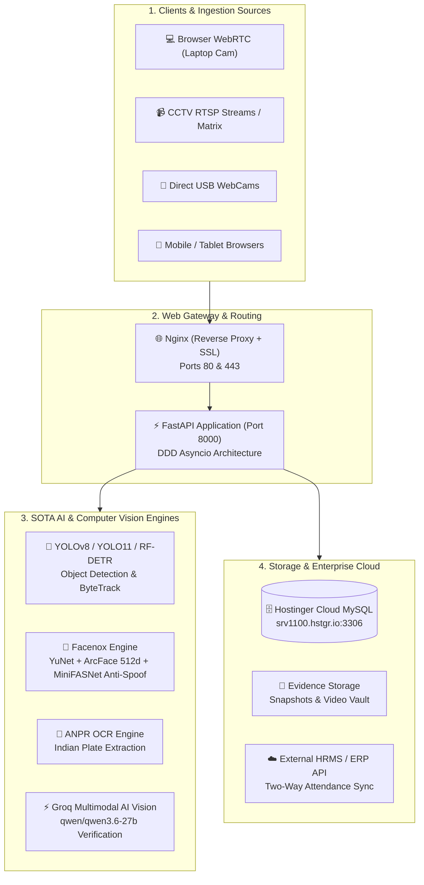
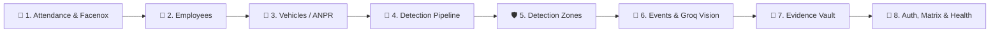
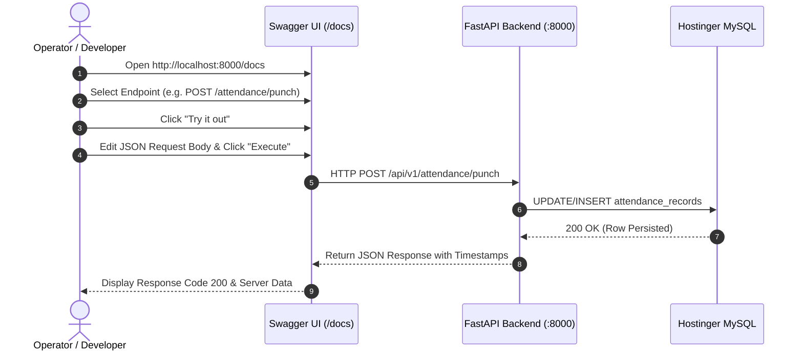

# 🛡️ Multi-Cam AI Surveillance & Attendance System
## Complete API Architecture & Endpoint Explanation Guide
> **Audience**: Developers, System Administrators & Security Operators  
> **Language**: Easy Hinglish (Simple English + Hindi)  
> **Status**: Production Verified | OpenAPI 3.1.0 Compatible

---

## 🏛️ System Architecture Overview

The **Multi-Cam AI Surveillance & Attendance Backend** acts as the central brain of the surveillance infrastructure. It ingests video feeds from CCTV cameras and webcams, processes them through deep learning models (YOLO, ArcFace, ANPR OCR, Groq Multimodal Vision), records biometric attendance, manages security zones, and persists all data to Hostinger Cloud MySQL.



---

## 🌐 Live Access & Interactive Swagger URLs

| Interface | Localhost (Development) | AWS EC2 (Production) | Description |
|:---|:---|:---|:---|
| 📑 **Interactive Swagger UI** | [http://localhost:8000/docs](http://localhost:8000/docs) | `https://18.117.247.217/docs` | Live interactive UI to test every endpoint with "Try it out" |
| 📖 **ReDoc Enterprise View** | [http://localhost:8000/redoc](http://localhost:8000/redoc) | `https://18.117.247.217/redoc` | Clean 3-panel API documentation view |
| ⚙️ **OpenAPI JSON Schema** | [http://localhost:8000/openapi.json](http://localhost:8000/openapi.json) | `https://18.117.247.217/openapi.json` | OpenAPI 3.1.0 spec for Postman and API clients |

---

## 📚 Module-by-Module Easy Explanation

The 84 operations in the backend are grouped into **8 core business modules**:



---

### 🪪 Module 1: Biometric Attendance & Facenox Platform

Yeh module staff attendance ka digital register hai jisme Face Recognition aur 1-Click Punching chalti hai.

#### 1. `POST /api/v1/attendance/punch` (1-Click Instant Punch)
* **Kyu use hota hai**: Employee ka Punch In ya Punch Out record karne ke liye (chahe security guard click kare ya automatic ho).
* **Input Body**:
  ```json
  {
    "employee_id": "103",
    "punch_type": "in",         // "in" for entry, "out" for exit
    "camera_name": "Gate-1 Terminal",
    "confidence": 99.5
  }
  ```
* **Kya hota hai**:
  * Agar `punch_type="in"` hai toh `first_seen` timestamp update hota hai aur employee "Punched In" mark hota hai.
  * Agar `punch_type="out"` hai toh `last_seen` timestamp update hota hai aur status "Punched Out" ho jata hai.
* **Output**: Complete updated attendance record returned with timestamps.

#### 2. `POST /api/v1/attendance/facenox-scan` (Real-Time Face AI Recognition)
* **Kyu use hota hai**: Live camera ke saamne jab koi insaan khada hota hai, tab uske chehre ko verify karke automatic attendance lagane ke liye.
* **Working Steps**:
  1. **YuNet Detector**: Frame me face detect karta hai (rotated ya angled chehra bhi detect hota hai).
  2. **Anti-Spoofing (MiniFASNetV2)**: Check karta hai ki asli insaan hai ya kisi ne photo/mobile screen dikhayi hai. Agar fake hai toh reject ho jata hai.
  3. **ArcFace 512-d Embedding**: Face ke 512 biometric numbers extract karta hai aur database me save employee vectors se match karta hai.
  4. **Auto-Attendance**: Match hone par automatically Hostinger MySQL me entry kar deta hai.

#### 3. `GET /api/v1/attendance` (Attendance History & Logs)
* **Kyu use hota hai**: Attendance sheet dekhne ke liye.
* **Filters**:
  * `date=2026-11-12`: Kisi particular din ki attendance dekhne ke liye.
  * `employee_id=103`: Kisi ek staff member ka record nikalne ke liye.
  * `search=Rameez`: Name se search karne ke liye.
  * `skip=0&limit=50`: Pagination ke liye.

#### 4. `POST /api/v1/attendance/sync-hrms` (Company HR Software Cloud Sync)
* **Kyu use hota hai**: External payroll/HRMS software (jaise Keka, Darwinbox, Zoho People) ke server par real-time punch data bhejne ke liye.

---

### 👥 Module 2: Employee Management (Staff Directory)

Office ya factory ke sabhi workers/employees ka master data aur unka face enrollment.

* **`GET /api/v1/employees`**: Sabhi registered employees ki list deta hai (Name, ID, Department, Designation, Face Registered: Yes/No).
* **`POST /api/v1/employees/register`**: Naye employee ko enroll karta hai. Form me unka photo ya face embedding vector saath me attach hota hai.
* **`GET /api/v1/employees/{employee_id}`**: Kisi ek employee ki personal details aur biometric status fetch karta hai.
* **`PATCH /api/v1/employees/{employee_id}`**: Designation, department ya contact number update karne ke liye.
* **`DELETE /api/v1/employees/{employee_id}/face`**: Purana face template delete karta hai (agar employee ka face re-enroll karna ho).
* **`DELETE /api/v1/employees/{employee_id}`**: Employee ka record system se remove karta hai.

---

### 🚗 Module 3: Vehicles & ANPR (Number Plate Reader)

Society, apartment ya office gate par aane wali gaadiyon ki number plate padhna aur parking record banana.

* **`POST /api/v1/vehicles/scan`**:
  * **Kaam**: Camera se car/bike ka snapshot leta hai, Tesseract OCR se plate number (jaise `JH03MF4477`, `UP16BT4321`) extract karta hai aur location (`Apartment Main Gate`) ke saath save karta hai.
* **`GET /api/v1/vehicles`**:
  * **Kaam**: Vehicle history table deta hai. Search parameter (`search=UP16`) se kisi specific car ka aane-jaane ka time check kiya ja sakta hai.
* **`DELETE /api/v1/vehicles`**:
  * **Kaam**: Test records ya purana history data clear karne ke liye.

---

### 🎯 Module 4: Detection Pipeline (Real-Time YOLO & Tracking)

Live CCTV camera stream pe AI object detection aur moving objects ki persistent tracking.

* **`GET /api/v1/detection/status`**:
  * **Kaam**: Pipeline ka health dashboard — Real-time FPS kitna mil raha hai, inference speed kitne ms hai, active tracks kitne hain, aur GPU memory usage kitni hai.
* **`GET /api/v1/detection/cameras/{camera_id}/tracks`**:
  * **Kaam**: Kisi camera stream me chal rahe har target ka unique `track_id` aur coordinates `[x, y, w, h]` deta hai. Isse insaan ke aage badhne par bhi uski identity maintain rehti hai (ByteTrack algorithm).
* **`WS /api/v1/objects/ws/object-detection` (WebSocket)**:
  * **Kaam**: Browser webcam se continuous frames leta hai aur zero latency ke saath screen par detection boxes draw karta hai.

---

### 🛡️ Module 5: Detection Zones (Security Boundaries & Tripwires)

Camera ke view ke andar virtual red lines ya danger zones draw karna.

* **`POST /api/v1/zones`**:
  * **Kaam**: Ek custom polygon boundary define karta hai (e.g. `type: "restricted"`, `name: "Server Room Entry"`).
* **`GET /api/v1/zones/camera/{camera_id}`**:
  * **Kaam**: Us camera me bane saare polygon zones ki boundary coordinates list karta hai.
* **`PATCH /api/v1/zones/{zone_id}`**:
  * **Kaam**: Zone ko chhota-bada karna ya uski sensitivity adjust karna.
* **`DELETE /api/v1/zones/{zone_id}`**:
  * **Kaam**: Kisi purane zone ko delete karna.

---

### 🚨 Module 6: Events & Groq Vision AI (Security Incidents & Review)

Security violations ko pakadna aur human operator ke saath verify karna.

* **`GET /api/v1/events`**:
  * **Kaam**: Saare recorded incidents (e.g. `zone_intrusion`, `after_hours_entry`, `unauthorized_vehicle`) ki list deta hai.
* **`POST /api/v1/events/vision-scan` (Groq Multimodal AI)**:
  * **Kaam**: Jab camera kisi choti cheez ko pakadta hai aur confirm nahi hota, tab Groq Vision (`qwen/qwen3.6-27b`) model frame ko dekh kar 99.9% accurate naam batata hai (jaise: `Computer Mouse`, `Smartphone`, `Pen`, `Gun`, `Backpack`).
* **`GET /api/v1/events/review-queue`**:
  * **Kaam**: AI dwara suspicious maane gaye unverified events ko filter karke security guard ke review ke liye dikhata hai.
* **`PATCH /api/v1/events/{event_id}/correct-label`**:
  * **Kaam**: Agar AI ne kisi cheez ko galti se galat bol diya, toh guard 1-click me uska sahi label update kar deta hai.

---

### 📸 Module 7: Evidence Vault (Snapshots & Video Proof)

Security incidents ka photo aur video proof store aur download karna.

* **`GET /api/v1/evidence`**: Saare available snapshots aur video files ki date-wise list deta hai.
* **`GET /api/v1/evidence/media/{id}`**: Direct image ya video ko browser me bina kisi download ke preview karta hai.
* **`POST /api/v1/evidence/signed-url/{id}`**: Ek temporary cryptographically signed download URL banata hai jo 5 minute me automatically expire ho jata hai taaki file leak na ho.
* **`GET /api/v1/evidence/download/{id}`**: Signed token verify karke original high-resolution evidence file download karwata hai.

---

### 🔑 Module 8: Auth, Tenants, Cameras & Health

Enterprise access control, multi-branch management aur health status.

* **`POST /api/v1/auth/token`**: Admin ya operator ka login karke secure JWT bearer token provide karta hai.
* **`GET /api/v1/tenants`**: Multi-tenant organizations manage karta hai (ek hi software alag-alag companies ke liye alag data rakhta hai).
* **`GET /api/v1/cameras`**: Saare CCTV cameras ke RTSP URLs aur camera status ko manage karta hai.
* **`GET /health`**: Ek ultra-lightweight ping endpoint jo `{"status": "healthy"}` return karta hai.

---

## 🧪 1-Click Testing Guide via Swagger UI

Swagger UI me kisi bhi endpoint ko test karne ka simple step-by-step tareeqa:



1. Browser me **`http://localhost:8000/docs`** kholiye.
2. Left side me category chuniye (jaise **Attendance** ya **Vehicles**).
3. Endpoint par click karke **"Try it out"** button dabayein.
4. Agar parameters ya request body hai toh value bharein aur **"Execute"** dabayein.
5. Response me aapko **Code 200** aur database se aaya live JSON data dikh jayega!

---

## 📌 Summary Cheatsheet

| Task | HTTP Method | Endpoint URL |
|:---|:---:|:---|
| 🟢 Punch In Lagana | `POST` | `/api/v1/attendance/punch` (`punch_type: "in"`) |
| 🔴 Punch Out Lagana | `POST` | `/api/v1/attendance/punch` (`punch_type: "out"`) |
| 🪪 Live Face Match Scan | `POST` | `/api/v1/attendance/facenox-scan` |
| 📅 Attendance Logs Dekhna | `GET` | `/api/v1/attendance` |
| 👤 Employee Register Karna | `POST` | `/api/v1/employees/register` |
| 🚗 Car Number Plate Scan | `POST` | `/api/v1/vehicles/scan` |
| 🏎️ Vehicle History Dekhna | `GET` | `/api/v1/vehicles` |
| 🎯 AI Health & FPS Dekhna | `GET` | `/api/v1/detection/status` |
| 🔍 Groq Vision Se Object Naming | `POST` | `/api/v1/events/vision-scan` |
| 📸 Evidence Download URL | `POST` | `/api/v1/evidence/signed-url/{id}` |
| 💚 Server Health Check | `GET` | `/health` |
