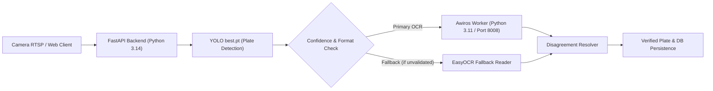

# Awiros ANPR OCR Persistent Local Worker

This module provides the production-grade, isolated worker service for **Awiros ANPR OCR (SVTR-LCNet)**.

## Why Isolation is Required
- **Python 3.14 Compatibility**: The main FastAPI surveillance backend runs on Python 3.14. PaddlePaddle (`paddlepaddle==2.6.2`) requires Python $\le 3.11$.
- **Process Isolation**: Running PaddlePaddle in a separate micro-process protects the core FastAPI server from C++ level memory allocations, segmentation faults, and JIT graph compilation pauses.
- **Micro-Daemon Model**: The worker persists in memory on `http://127.0.0.1:8008`, eliminating model initialization latency on video streams and HTTP scans.

---

## Architecture Diagram



---

## Directory Structure
```text
awiros_worker/
├── worker.py                 # Multi-threaded HTTP daemon
├── requirements_worker.txt   # Pinned Python 3.11 dependencies
├── start_worker.bat          # Windows startup launcher
├── start_worker.sh           # Linux / AWS EC2 startup launcher
├── awiros_worker.service     # Linux systemd service unit
├── README.md                 # This documentation
└── models/                   # Model weights directory (gitignored)
    ├── model.safetensors     # Official HuggingFace weights (142.5 MB)
    ├── en_dict.txt           # CTC character alphabet
    └── PaddleOCR/            # PaddleOCR framework core
```

---

## Quick Setup Instructions

### 1. Create Python 3.11 Virtual Environment
```bash
# On Linux / AWS EC2:
python3.11 -m venv venv
source venv/bin/activate
pip install --upgrade pip
pip install -r requirements_worker.txt

# On Windows:
python -m venv venv
venv\Scripts\activate
pip install -r requirements_worker.txt
```

### 2. Download Model Weights
```bash
# Using huggingface_hub:
python -c "from huggingface_hub import hf_hub_download; hf_hub_download(repo_id='Awiros/anpr-ocr', filename='model.safetensors', local_dir='models')"
```

### 3. Run Worker
```bash
python worker.py --port 8008
```

### 4. Verify Health Check
```bash
curl http://127.0.0.1:8008/health
# Response: {"status": "ready", "model": "awiros_anpr_ocr", "device": "cpu"}
```

